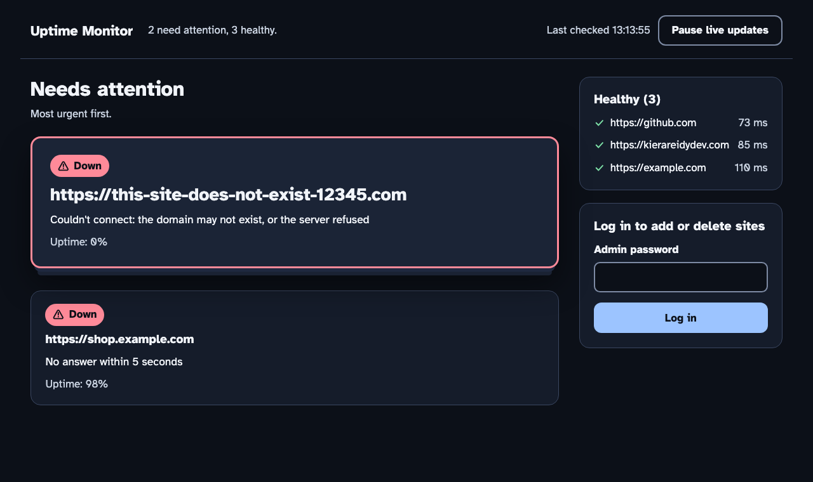
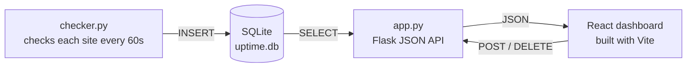

# Uptime Monitor


A self-hosted website uptime monitor. It checks a list of websites every 60 seconds, records whether each one was up, how fast it responded and **why it failed**, and shows the problems that need attention first. The React dashboard is built to **WCAG 2.2 AAA**, the highest level of the web accessibility guidelines.



## Features

- Checks every site once a minute and records the status code, response time and the reason for any failure: domain not found, no answer within 5 seconds, or an HTTP error such as `503`
- **Needs attention first:** problem sites are shown as cards, most urgent first, each with the reason in plain English
- Healthy sites are listed separately with their average response time
- The dashboard refreshes every 30 seconds, with a button to pause live updates and a "last checked" time
- If the server can't be reached, the dashboard says so instead of pretending everything is fine
- Admin login: anyone can view the dashboard, but only you can add or delete sites
- Add a site with instant validation, and delete one through a confirmation dialog
- Discord alerts when a site goes down or comes back up

### Accessibility (WCAG 2.2 AAA)

- Text contrast of at least 7:1, using the Atkinson Hyperlegible font
- Status is never shown by colour alone: every status has an icon and a word
- Buttons and inputs are at least 44 px tall
- Fully usable with a keyboard, with a thick, high-contrast focus outline and a "skip to main content" link
- Focus moves to the right place after logging in, logging out and deleting a site
- Live updates can be paused, changes are announced politely to screen readers, and animation is switched off for people who prefer reduced motion
- Form hints are shown before you type, and errors are linked to their field

## How it works



- **`checker.py`** runs in the background. Each round it reads the list of sites from the database, requests each one, and saves the result.
- **`app.py`** is a Flask server. It serves the built React app and a JSON API that the app calls with `fetch`.
- **`frontend/`** is the React app. In development, Vite serves it and forwards `/api` requests to Flask. For production, `npm run build` turns it into static files that Flask serves.

The dashboard and the API come from the same server, so the browser doesn't need any CORS setup.

### Database

| Table | Columns |
|---|---|
| `sites` | `id`, `url` (unique) |
| `checks` | `id`, `site_id` → `sites.id`, `status_code`, `response_ms`, `error`, `checked_at` |

A check counts as "up" if it got a status code under 400. If the site couldn't be reached at all, `status_code` and `response_ms` are `NULL`. `error` holds the reason for a failed check, and is `NULL` when the site was up.

### API

| Method | Endpoint | What it does |
|---|---|---|
| `GET` | `/api/sites` | Every site with its status, latest error, uptime %, check counts and average response time |
| `GET` | `/api/sites/<id>/checks` | The 50 most recent checks for one site |
| `POST` | `/api/sites` | Adds a site. Body: `{"url": "https://example.com"}`. Returns `201`, or `409` if the site already exists |
| `DELETE` | `/api/sites/<id>` | Deletes a site and its checks. Returns `404` if the site doesn't exist |
| `POST` | `/api/login` | Logs in. Body: `{"password": "..."}`. Returns `401` if the password is wrong |
| `POST` | `/api/logout` | Logs out |
| `GET` | `/api/me` | `{"admin": true}` if you're logged in, otherwise `false` |

Adding and deleting sites returns `401` unless you're logged in.

## Running it

### With Docker (easiest)

```bash
git clone https://github.com/KeeLouise/uptime-monitor.git
cd uptime-monitor
docker build -t uptime-monitor .
docker run -d --name uptime -p 5001:5001 -v uptime-data:/app/data \
  -e ADMIN_PASSWORD=choose-a-password \
  -e SECRET_KEY=paste-a-random-key-here \
  uptime-monitor
```

Generate a secret key with `python -c "import secrets; print(secrets.token_hex(32))"`, then open **http://127.0.0.1:5001**.

The image is built in two stages: a Node stage builds the React app, then only the built files are copied into the Python image. One container runs both the checker and the web server. The database is stored in the `uptime-data` volume, so your history survives restarts and rebuilds.

### For development

You need Python 3 and Node 20 or newer.

```bash
git clone https://github.com/KeeLouise/uptime-monitor.git
cd uptime-monitor
python3 -m venv .venv
source .venv/bin/activate
pip install -r requirements.txt
cd frontend && npm install && cd ..
```

Then run these in three terminals, with the virtual environment active in the first two:

```bash
python checker.py
```

```bash
ADMIN_PASSWORD=choose-a-password python app.py
```

```bash
cd frontend
npm run dev
```

Open the address Vite prints, usually **http://localhost:5173**. Changes to the React code show up as soon as you save. The Flask server uses port 5001 because macOS uses port 5000 for AirPlay.

### Tests

```bash
pytest                                  # API tests
cd frontend && npm run lint && npm run build
```

GitHub Actions runs all three on every pull request.

## Built with

- **Python:** Flask, `requests`, `sqlite3`, pytest
- **React 19** with Vite, and **React Aria Components** for the form fields and the confirmation dialog
- **CSS:** hand-written, built to WCAG 2.2 AAA
- **Deployment:** Docker multi-stage build, gunicorn as the production web server
- **CI:** GitHub Actions

## What I learned

<!-- Write a few sentences in your own words. Ideas: what was hardest, a bug you're proud of fixing, what "accessible" means to you now. -->

## Roadmap

- [x] Discord alerts when a site goes down or comes back up
- [x] Tests with `pytest`
- [x] Rebuild the dashboard in React, to WCAG 2.2 AAA
- [ ] Site detail page: uptime history, response-time chart, and results by region
- [ ] User accounts, so each person sees only their own sites
- [ ] SSL certificate expiry warnings and slow-response alerts
- [ ] Deploy it with a live demo link
