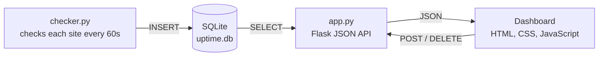

# Uptime Monitor


A self-hosted website uptime monitor with a Windows 95-style dashboard. It checks a list of websites every 60 seconds, records whether each one was up and how fast it responded, and shows the history in the browser.


## Features

- Admin login: anyone can view the dashboard, but only you can add or delete sites
- Checks every site once a minute and records the status code and response time
- Counts timeouts and connection failures as downtime instead of crashing
- Shows uptime % and average response time for each site
- Uptime history strip: one block per recent check, green for up and red for down
- Response-time chart for each site (hover over a bar to see the exact time)
- Add a site from the dashboard, which rejects duplicates
- Delete a site, and its history, with the window's × button
- The dashboard refreshes itself every 30 seconds

## How it works



The project has two Python programs that share one SQLite database:

- **`checker.py`** runs in the background. Each round it reads the list of sites from the database, requests each one, and saves the result.
- **`app.py`** is a Flask server. It serves the dashboard page and a JSON API that the page calls with `fetch`.

The dashboard and the API come from the same server, so the browser doesn't need any CORS setup.

### Database

| Table | Columns |
|---|---|
| `sites` | `id`, `url` (unique) |
| `checks` | `id`, `site_id` → `sites.id`, `status_code`, `response_ms`, `checked_at` |

A check counts as "up" if it got a status code under 400. If the site couldn't be reached at all, `status_code` and `response_ms` are `NULL`.

### API

| Method | Endpoint | What it does |
|---|---|---|
| `GET` | `/api/sites` | Every site with its status, uptime %, check counts and average response time |
| `GET` | `/api/sites/<id>/checks` | The 50 most recent checks for one site |
| `POST` | `/api/sites` | Adds a site. Body: `{"url": "https://example.com"}`. Returns `201`, or `409` if the site already exists |
| `DELETE` | `/api/sites/<id>` | Deletes a site and its checks. Returns `404` if the site doesn't exist |
| `POST` | `/api/login` | Logs in. Body: `{"password": "..."}`. Returns `401` if the password is wrong |
| `POST` | `/api/logout` | Logs out |
| `GET` | `/api/me` | `{"admin": true}` if you're logged in, otherwise `false` |

Adding and deleting sites returns `401` unless you're logged in.


## Running it locally

### With Docker (easiest)

```bash
git clone https://github.com/KeeLouise/uptime-monitor.git
cd uptime-monitor
docker build -t uptime-monitor .
Generate a secret key with `python -c "import secrets; print(secrets.token_hex(32))"`.
uptime-monitor
```

This one container runs both the checker and the web server. The database is stored in the `uptime-data` volume, so your history survives restarts and rebuilds.

### Without Docker

You need Python 3.

```bash
git clone https://github.com/KeeLouise/uptime-monitor.git
cd uptime-monitor
python3 -m venv .venv
source .venv/bin/activate
pip install -r requirements.txt
```

Then start the checker and the server in two separate terminals, with the virtual environment active in each:

```bash
python checker.py
```

```bash
ADMIN_PASSWORD=choose-a-password python app.py

```

Open **http://127.0.0.1:5001** in your browser. The server uses port 5001 because macOS uses port 5000 for AirPlay.

## Built with

- **Python:** `requests`, `sqlite3`, Flask
- **JavaScript:** no framework, just `fetch`, `async`/`await` and DOM methods
- **CSS:** hand-written Windows 95 theme with no images
- **Deployment:** Docker, with gunicorn as the production web server


## Roadmap

- [x] Discord alerts when a site goes down or comes back up
- [x] Tests with `pytest`
- [ ] Deploy it with a live demo link
- [ ] Rebuild the dashboard in React
